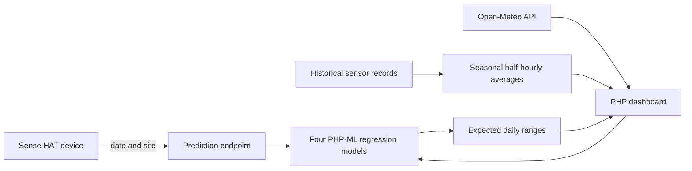

# IoT Weather Prediction Dashboard

A full-stack weather dashboard that combines a Raspberry Pi Sense HAT workflow, PHP machine-learning models, historical sensor data, and live weather observations. It estimates daily minimum and maximum temperature and humidity for five Tasmanian locations, then makes the expected range easy to compare with current conditions.

**Live demo:** https://weather.tanvirrahman.dev/

## What it does

- Predicts daily temperature and humidity ranges for Wynyard, Launceston, Smithton, Hobart, and Campania.
- Shows a rolling 10-day forecast with daily temperature, humidity, and weather-condition icons.
- Uses Open-Meteo daily forecast guidance for the live dashboard, with the local seasonal model available as a fallback if the provider is unavailable.
- Serves the historical same-day chart from a precomputed cache instead of scanning the 1M+ row sensor CSV for every visit.
- Shows the seasonal half-hourly pattern for the selected location.
- Retrieves current daily observations from the Open-Meteo API when available.
- Exposes a small JSON endpoint for a Sense HAT device or other client to request a prediction.
- Uses the Sense HAT display to flag readings that fall inside or outside the expected range.

The dashboard answers a practical question: is the current reading normal for this place and time of year, rather than merely reporting the reading itself?

## How it works



## Data and model

The included training CSV contains 1,033,307 half-hourly readings. The original project data covers 2015–2021; the 2022–2026 extension is **synthetic**, generated from per-site, per-month, and per-time-slot averages with controlled noise. It is included to demonstrate the pipeline and interface, not as a substitute for newly collected observations.

Training first aggregates the readings to one daily minimum/maximum record per site. Four `PHP-ML` `LeastSquares` models then estimate seasonal baseline ranges:

| Target | In-sample project R² |
| --- | ---: |
| Maximum temperature | 0.84 |
| Minimum temperature | 0.84 |
| Maximum humidity | 0.68 |
| Minimum humidity | 0.82 |

The features are seasonal sine/cosine terms, site indicators, and site-by-season interactions. This keeps the model interpretable and lets each location have its own annual pattern. These R² values are in-sample project metrics, not an out-of-sample accuracy guarantee—especially because the 2022–2026 extension is synthetic.

For a live forecast, the dashboard prefers the Open-Meteo daily forecast feed, including provider weather codes for the icons. The local PHP-ML seasonal model remains available as a transparent fallback. This improves practical day-to-day forecast quality while preserving the original IoT/ML work as a reproducible baseline.

`build_dashboard_cache.php` is run when the training CSV changes. It creates `Training_data/dashboard_seasonal_averages.json`, allowing the historical chart to render quickly without re-reading the full CSV for every visitor.

## Technology

| Area | Tools |
| --- | --- |
| Dashboard and API | PHP 8, Apache |
| Machine learning | PHP-ML `LeastSquares` regression |
| Device integration | Raspberry Pi Sense HAT (`sensor.py`) |
| Visualisation | CanvasJS, Bootstrap, jQuery |
| Current conditions | Open-Meteo API |
| Deployment | Railway or Vercel Container runtime |

## Run locally

Requirements: PHP 8.1+ and Composer. The provided models and training CSV are already committed for a repeatable demo.

```bash
composer install
php -d memory_limit=512M -S localhost:8080
```

Open http://localhost:8080/index.php.

To retrain the models after replacing the dataset:

```bash
php -d memory_limit=2048M train_and_save_models.php
```

The device/API endpoint accepts a date and site identifier:

```text
/recordDeviceData.php?date=2026-11-02&site_id=2
```

It returns a JSON prediction. The endpoint validates both inputs and is stateless, so it works on serverless/container deployments without writing request data to the application filesystem.

## Deploy on Vercel

The repository includes `Dockerfile.vercel`, which builds the PHP application and Composer dependency in a Vercel-compatible container. Import the GitHub repository into Vercel or deploy from the project root. Vercel detects `Dockerfile.vercel` and routes traffic to the container automatically.

The deployment is intentionally stateless. It does not store device requests; use a managed database or telemetry service if you later need durable device history.

## Project layout

```text
index.php                    Dashboard UI
recordDeviceData.php         JSON prediction endpoint
load_and_predict.php         Restores models and generates predictions
average_temp_humid.php       Builds historical half-hourly averages
train_and_save_models.php    Trains and saves the four models
sensor.py                    Raspberry Pi Sense HAT client
Training_data/               Versioned training dataset
Saved_models/                Versioned trained PHP-ML models
Dockerfile.vercel            Vercel container deployment
```

## Limitations and next steps

- Replace the synthetic 2022–2026 extension with verified recent sensor data.
- Evaluate on a true held-out time period before presenting the model as a forecast service.
- Add wind, pressure, and cloud cover as features.
- Compare the linear baseline with tree-based or gradient-boosting models.
- Store real device telemetry in a managed database if historical monitoring is needed.
