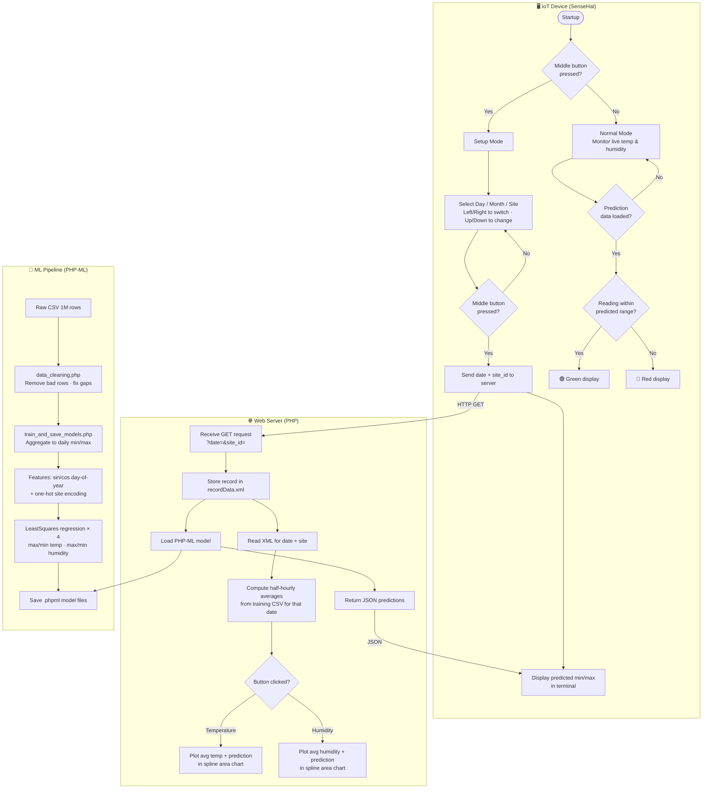

# Weather Prediction Dashboard

**Live demo:** https://weather-prediction-dashboard-production.up.railway.app/

A full-stack IoT weather forecasting system that combines a Raspberry Pi SenseHat device, a PHP/ML server, and an interactive web dashboard to predict and compare daily temperature and humidity ranges across five Tasmanian weather monitoring sites.

---

## What Problem It Solves

Standard weather sensors tell you what the conditions are *right now*, but give no context for whether that reading is normal for the time of year and location. This system bridges that gap by:

- **Predicting** the expected min/max temperature and humidity for any date and location using a machine learning model trained on 10+ years of historical sensor data
- **Comparing** the SenseHat's live readings against those predictions in real-time, lighting the display green (within range) or red (anomalous)
- **Visualising** the historical half-hourly averages alongside the ML prediction on an interactive web dashboard, so you can see the seasonal pattern at a glance

The result is a contextual sensor — not just "it's 14°C" but "14°C is within the normal range for Hobart in June."

---

## System Architecture



---

## Monitoring Sites

| Site ID | Location   |
|---------|------------|
| 1       | Wynyard    |
| 2       | Launceston |
| 3       | Smithton   |
| 4       | Hobart     |
| 5       | Campania   |

---

## Machine Learning Approach

**Algorithm:** Supervised linear regression (PHP-ML `LeastSquares`)

**Why linear regression?**
Weather patterns are strongly cyclical and location-dependent. Linear regression over carefully engineered features is interpretable, fast to train, and avoids overfitting on a relatively small feature space.

**Feature engineering:**

| Feature | Description |
|---|---|
| `sin(2π · doy / 365)` | Cyclical day-of-year — sine component |
| `cos(2π · doy / 365)` | Cyclical day-of-year — cosine component |
| `is_site_1 … is_site_5` | One-hot encoded site ID |

Raw timestamps were deliberately excluded — using unix timestamps as a linear feature caused the model to treat time as monotonically increasing, producing nonsensical extrapolations. The sin/cos encoding maps any day-of-year onto the unit circle, so the model sees the same seasonal position regardless of year.

**Training pipeline:**
1. Load `cleaned_training_data.csv` (~1M half-hourly readings, 2015–2026)
2. Aggregate to one row per `(date, site)` — daily min/max for temp and humidity (~20k samples)
3. Build 7-feature vectors and train 4 separate models
4. Serialize to `Saved_models/*.phpml`

**Model accuracy (R²):**

| Model | R² |
|---|---|
| Max Temperature | 0.84 |
| Min Temperature | 0.84 |
| Max Humidity | 0.68 |
| Min Humidity | 0.82 |

---

## Project Structure

```
.
├── index.php                  # Web dashboard — charts + prediction cards
├── recordDeviceData.php       # API endpoint: stores XML record, returns JSON prediction
├── load_and_predict.php       # Loads saved models and generates predictions
├── average_temp_humid.php     # Computes half-hourly historical averages for chart
├── train_and_save_models.php  # Trains and serialises the 4 regression models
├── data_cleaning.php          # Cleans raw sensor CSV
├── generate_2026_data.py      # Extends training data to 2026 with synthetic records
├── sensor.py                  # SenseHat IoT device script
├── recordData.xml             # Persisted device request records
├── Training_data/             # (gitignored) raw + cleaned CSV datasets
├── Saved_models/              # (gitignored) serialised .phpml model files
└── canvasjs3.6/               # CanvasJS charting library
```

---

## Setup

### 1. Install PHP dependencies
```bash
composer install
```

### 2. Generate training data (optional — extends to 2026)
```bash
python3 generate_2026_data.py
```

### 3. Train the models
```bash
php -d memory_limit=2048M train_and_save_models.php
```

### 4. Run the server
```bash
php -d memory_limit=2048M -S localhost:8080
```

Open [http://localhost:8080/index.php](http://localhost:8080/index.php)

---

## Scope for Improvement

- **Additional features** — wind speed, atmospheric pressure, and cloud cover would capture weather patterns that pure seasonality misses
- **Non-linear models** — random forests or gradient boosting would capture interaction effects between site and season that linear regression cannot represent
- **Larger dataset** — more years of real (not synthetic) sensor data would reduce reliance on seasonality averages
- **Feedback loop** — storing live SenseHat readings back into the training set over time would allow the model to self-improve


